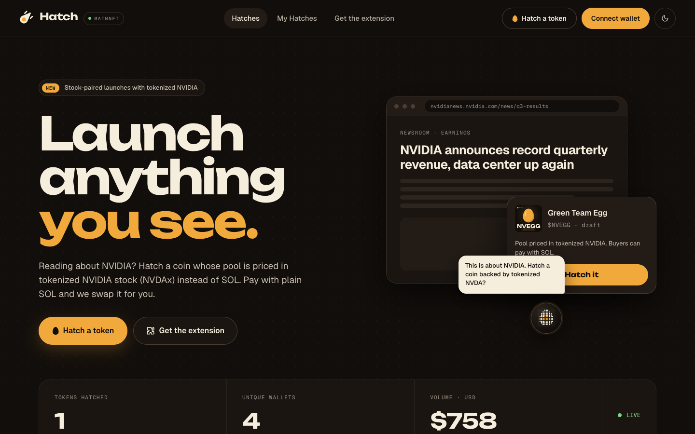
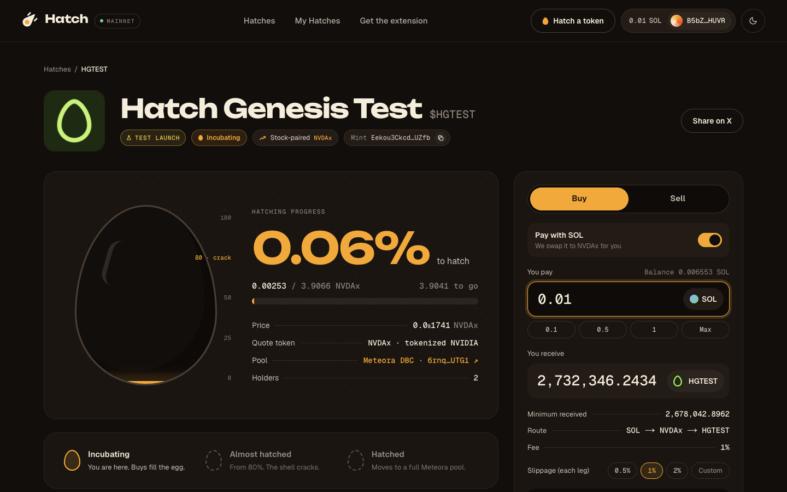
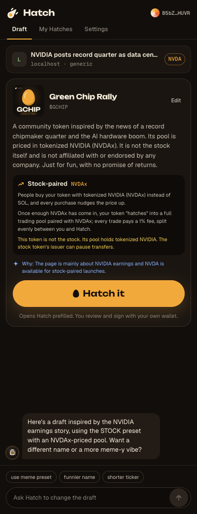
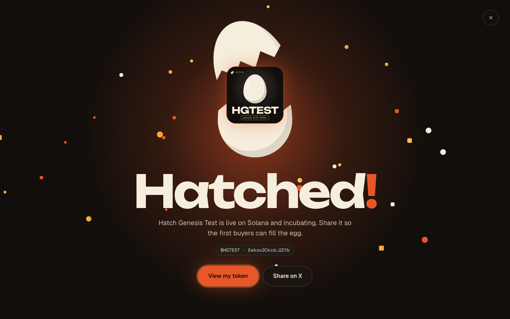
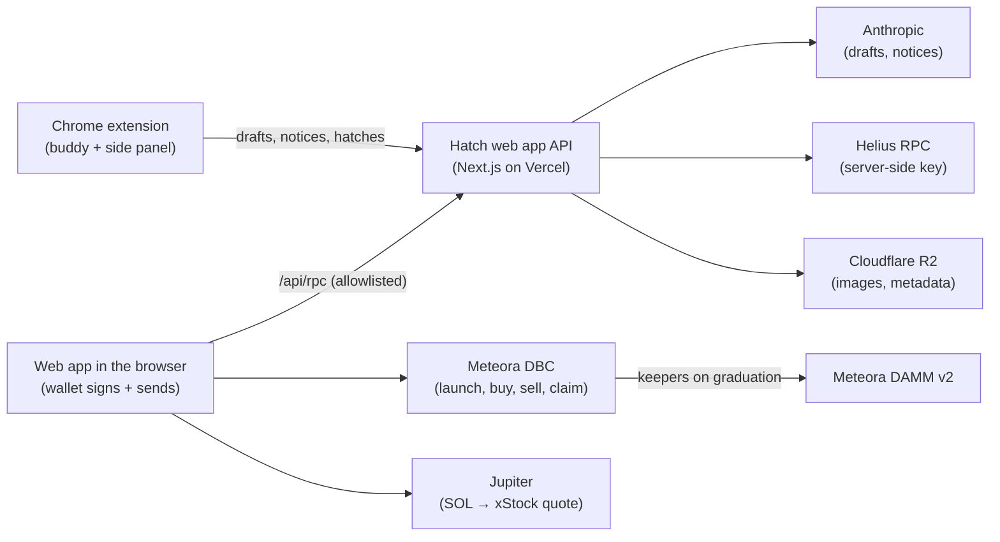

# Hatch

**Launch anything you see.**

A Chrome buddy that spots coin-worthy pages, drafts a token with AI, and launches it on Meteora's
Dynamic Bonding Curve. The headline feature: **stock-paired launches**, where the pool is priced in
tokenized stock (NVDAx or TSLAx) instead of SOL, and buyers can still pay with plain SOL. Every launch
ships with a **Sniper shield**: fees start high for the first minute so bots pay, then drop to 1%.



<!-- Demo GIF slot: docs/media/demo.gif -->

- **Spot it.** A little dot-matrix chicken floats on the page. On a stock page or a tweet it turns into an egg and offers a coin idea.
- **Draft it.** The side panel drafts name, ticker, description, preset and image with AI. You edit it in plain words ("shorter ticker").
- **Hatch it.** One click opens the web app prefilled. You sign with your own wallet. The token incubates on a Meteora bonding curve and hatches into a full Meteora pool.

**Live:** [hatchfun.vercel.app](https://hatchfun.vercel.app) · **Extension:** [download for Chrome](https://hatchfun.vercel.app/extension) (load unpacked, ID `knfkjiebkbhddjogcbniiachhomkmdkm`)

| Token page | Side panel | Hatched! |
|---|---|---|
|  |  |  |

## How Hatch uses Meteora

- **DBC configs as presets.** Each launch preset (Stock-paired NVDA and TSLA, Meme, AI agent) is a Dynamic Bonding Curve config Hatch created and owns as partner. The server only builds launches against this allowlist.
- **Stock-paired launches.** Each stock config's quote token is a real xStock (NVDAx, TSLAx: Token-2022 with a scaled UI amount, permanent delegate and pausable). Each uses its **Meteora token badge** so DBC accepts it as a quote mint.
- **Token-2022 base tokens.** Every launch mints a Token-2022 base token: no Metaplex fee, metadata in the mint.
- **Fee scheduler (Sniper shield).** v2 configs use DBC's exponential fee scheduler: 50% at launch, down to 1% after 60 seconds.
- **Partner fees to Hatch.** Trades pay a 1% fee after the shield (plus DBC's dynamic fee), split 50/50 between the token's creator and Hatch as partner. Creators claim from the token page; the partner claims with `scripts/claim-partner-fees-mainnet`.
- **Auto-graduation.** When the quote raised reaches the config's threshold, Meteora's keepers migrate the pool to **DAMM v2**. Stock thresholds (3.99 NVDAx, 2.52 TSLAx, each ≈ $938 at creation) are set 25% above the keepers' $750 minimum.
- **Pay with SOL.** For xStock-quoted pools, a buyer with no xStock pays SOL: Hatch builds **one versioned transaction** with Jupiter's SOL→xStock swap and the DBC buy. Both legs are slippage-protected; the DBC leg spends Jupiter's guaranteed minimum. It falls back to two steps if a route is too large.

## Presets v2

Our first mainnet launch was sniped by a bot within seconds. So every v2 preset ships with a **Sniper shield**,
and the configs were paid for with the partner fees that bot's trades left behind: Hatch claimed them, swapped
the NVDAx to SOL, and used it to create the four configs below.

**The Sniper shield, in plain words:** a new token's trading fee starts at 50% and drops every 5 seconds,
reaching the normal 1% one minute after launch. A bot buying in the first seconds pays a big fee (shared by the
creator and Hatch); people buying a minute later pay the usual 1%. The token page shows the live fee while it
drops. It is DBC's exponential fee scheduler (12 steps over 60 s), enforced on chain by Meteora's program.

| Preset | Config | Quote | Hatches at | Fees |
|---|---|---|---|---|
| Stock-paired NVDA | [`BMHNjCP16u6Dch1mW6qe1zfHEJJpRkmrXi5aZw1ogL1y`](https://solscan.io/account/BMHNjCP16u6Dch1mW6qe1zfHEJJpRkmrXi5aZw1ogL1y) | NVDAx | 3.99 NVDAx (≈ $938) | 50/50 creator · Hatch |
| Stock-paired TSLA | [`HJKEzsNZGHSgSzfHdFeLfAKWcefYYo4Sd5DNiaDvfWYP`](https://solscan.io/account/HJKEzsNZGHSgSzfHdFeLfAKWcefYYo4Sd5DNiaDvfWYP) | TSLAx | 2.52 TSLAx (≈ $938) | 50/50 creator · Hatch |
| Meme | [`HoRw7tSgAXg2XUUDckRG4GWtC3DX21RC4RKB5PNittym`](https://solscan.io/account/HoRw7tSgAXg2XUUDckRG4GWtC3DX21RC4RKB5PNittym) | SOL | 10 SOL | 50/50 creator · Hatch |
| AI agent | [`B9rKSC6vQHrvvzjn4yakiU4euW54SYS1e58QVh8F26CB`](https://solscan.io/account/B9rKSC6vQHrvvzjn4yakiU4euW54SYS1e58QVh8F26CB) | SOL | 10 SOL, gentler curve | 80/20 creator · Hatch |

The v1 configs (STOCK-NVDAx, MEME) take no new launches. Their pools, like HGTEST, keep working: the app still
recognizes them for presets, stats and trading.

## Live on mainnet

| What | Address |
|---|---|
| v2 configs | see [Presets v2](#presets-v2) |
| NVDAx (quote) · DBC token badge | [`Xsc9qvGR…x9qEh`](https://solscan.io/token/Xsc9qvGR1efVDFGLrVsmkzv3qi45LTBjeUKSPmx9qEh) · [`mfacWnGh…9vBM`](https://solscan.io/account/mfacWnGh1Kn5ttHMMaNZhRZbCjvGrDQyDyZgqaR9vBM) |
| TSLAx (quote) · DBC token badge | [`XsDoVfqe…JhzoB`](https://solscan.io/token/XsDoVfqeBukxuZHWhdvWHBhgEHjGNst4MLodqsJHzoB) · [`XhM8atXD…n1ax`](https://solscan.io/account/XhM8atXDua58KZnZFLu5vJjzaNWjXaEvpPPEVnHn1ax) |
| STOCK-NVDAx config (v1, legacy) | [`HX9EjDXFjazM5gLyN2hUG5SRsH9BMorKi1EhVVw1BzJ6`](https://solscan.io/account/HX9EjDXFjazM5gLyN2hUG5SRsH9BMorKi1EhVVw1BzJ6) |
| MEME config (v1, legacy) | [`HjeeZN7aDtgfAoiVh8F17GeAKVAg4DFJsHx8Ap2GUfqv`](https://solscan.io/account/HjeeZN7aDtgfAoiVh8F17GeAKVAg4DFJsHx8Ap2GUfqv) |
| HGTEST mint ("Hatch Genesis Test", a test launch) | [`Eekou3Ckcd2Hxk1MaeVepRafCH6SHU7sybNrifizUZfb`](https://solscan.io/token/Eekou3Ckcd2Hxk1MaeVepRafCH6SHU7sybNrifizUZfb) |
| HGTEST DBC pool | [`6rnqNK44b77XUWcYBF1MCkzdfnfY6nCME7C6KhXkUTG1`](https://solscan.io/account/6rnqNK44b77XUWcYBF1MCkzdfnfY6nCME7C6KhXkUTG1) |

| Key transaction | Solscan |
|---|---|
| Create STOCK-NVDAx config (v1) | [2DrbY9…NoqGWN](https://solscan.io/tx/2DrbY9Fj1xDo7gS6f9ymwx65vmuHzCyduHdB9RmY97kR4mLksVTbdBFwDrJPxF9MKfkCAtHCYPTBZKXQFhoNoGWN) |
| Launch HGTEST (Token-2022 base, NVDAx quote) | [3onf33…Es3vbH](https://solscan.io/tx/3onf33ZByRzzHctAyKuM6ZgMu7YexD9tU3KKf6Dh6rTd1hNfHs5eiM1hvoDabvZApdCqJ8iZiKTiuf97a4Es3vbH) |
| Jupiter SOL → NVDAx | [5Sso5s…MkUAg5o](https://solscan.io/tx/5Sso5sATTXx7vgPqFQxVHkzagrpFFzRb7sGdGSzH61e3ownHemtw5ubh5R2sADMoNjJQhvkHQeNFD6sX2MkUAg5o) |
| First buy of HGTEST with NVDAx | [552BV4…rjqj6Kq](https://solscan.io/tx/552BV4veLmonNWKmiXeFKZKbAk1Gtm4NqPXzCvsGojHTn5oBQ95fe5YPdejLZGEE94CjKau6KyL2SKGx9rjqj6Kq) |
| Create MEME config (v1) | [3aEnFx…j81qdDzF](https://solscan.io/tx/3aEnFxMePdsvYSUfgAbfhUXYTCnJqhsNoqSR6SgBr4c8yqnR38PXNUKf6tmhnPzD5a6Q9z4HjytuaHpnj81qdDzF) |
| Claim partner fees from HGTEST (the sniper's fees) | [4HSpnH…dBc9uF](https://solscan.io/tx/4HSpnHGncmvoJtigQAkBV5uTtdKhvGpq9mRpRuvGqos3FFfeeeiSYNqa3mnM3hRxcDo1MvkRbF4cEDSyBodBc9uF) |
| Swap those NVDAx fees to SOL | [dkLTds…xcQPkJ](https://solscan.io/tx/dkLTdsfCF66EBAXsA7cZLQSDSDEn2gvZEH2eRFWkQCJtDAeiCrzsptpTE4oatxaHt9jq5Rni2dx8dpYoRxcQPkJ) |
| Create STOCK-NVDA-v2 config | [3RNwHY…EmidGB](https://solscan.io/tx/3RNwHYFNQfBKgTBUk1JuMfKtZs9qK1735KybRktp3r7V1gZUs4NjDStoTquSmzgzxWthKtJGdT5bAmAeDzEmidGB) |
| Create AI_AGENT config | [3bHAFg…fomtGx](https://solscan.io/tx/3bHAFgdCUDdwGBmGJScz6WuXsytsAagbwfWxcXihW76tTaeLdHXfaNEMZMU1Kx2Ubt7YJ8Yu81asjY1MnifomtGx) |
| Create MEME-v2 config | [zfrkZE…phgSgu](https://solscan.io/tx/zfrkZEtM7Fg99pn1oCDuwzTa6ohcj9kechmHw2zRPJmivb1BQF6QbGVrtPMn3uhiYPiukhRReMDk6ee49phgSgu) |
| Create STOCK-TSLA config | [3pcznj…VxsVcg](https://solscan.io/tx/3pcznja6C4LcEuKHuKCF9x7uXvogtUUnXuczkC4m4eSeWv49RvRxTS3jzvVNEzp26CoVSQvQSFob8dMdo6VxsVcg) |

## Architecture



More in [docs/ARCHITECTURE.md](docs/ARCHITECTURE.md).

## Privacy

- The extension holds **no keys, wallets or API keys**. All AI calls go through the Hatch server.
- **Automatic hints** happen only on stock pages and tweets (a setting turns them off), once per page. They send the page title, URL without query string or hash, and a short text excerpt.
- **Drafts** happen when you ask, except that stock pages and tweets are drafted when you open the panel. They send the page title, URL without query or hash, visible text and image links.
- The only identifier stored is your public wallet address, reported by the web app after you connect.
- No `tabs` permission: the page and its URL come from Hatch's own content script.

## Security notes

- **The server never signs.** `/api/upload` returns an unsigned transaction; your wallet signs and sends it.
- **Config allowlist.** Launches are built only against Hatch's own DBC configs; unlisted stocks are refused.
- **Write-once metadata.** Uploads are refused for mints that already exist, and R2 objects are create-only, so a live token's metadata can't be replaced.
- **RPC proxy.** The browser's RPC is `/api/rpc`: allowlisted methods, `getProgramAccounts` only on DBC and only with filters, batches of at most 5, per-IP budget. The provider key stays server-side.
- **Rate limits and caps.** Per-IP limits on every route, plus daily caps on AI calls. Fetching user-supplied image URLs is SSRF-guarded: DNS is resolved and private ranges are refused.

## Run locally

```bash
# web (Next.js): devnet by default
cd web && pnpm install
cp .env.example .env.local             # fill in R2, Anthropic, RPC
pnpm dev                               # http://localhost:3000
pnpm dev:mainnet                       # mainnet, reads .env.mainnet.local (see .env.mainnet.example)
pnpm test                              # unit tests

# extension (WXT, Chrome MV3)
cd extension && pnpm install
pnpm build                             # dist/chrome-mv3 -> chrome://extensions -> Load unpacked
pnpm build:prod                        # against https://hatchfun.vercel.app
pnpm test

# scripts (configs, launches, fee claims): devnet by default, simulate-first
cd scripts && pnpm install && cp .env.example .env
pnpm status-mainnet                    # read-only
pnpm claim-partner-fees-mainnet        # simulates; --mainnet --live + typed YES MAINNET to send
pnpm create-config-v2-mainnet meme-v2  # same rules; presets: stock-nvda-v2, stock-tsla, meme-v2, ai-agent
```

## Roadmap

- More xStocks (AAPL, …): each needs its own DBC config with a token badge.
- Fee routing to the original creator of the page a token was hatched from.
- Voice: talk to the buddy.

## Credits

Built on Meteora's fun-launch scaffold and SDKs. The orb uses thinking-orbs. See [CREDITS.md](CREDITS.md) and [LICENSE](LICENSE).
