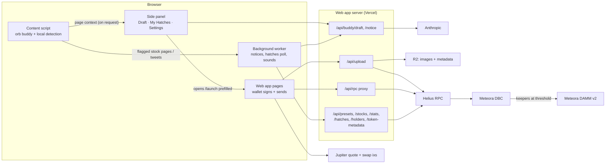

# Architecture

Three parts: a Chrome extension that notices and drafts, a Next.js web app that builds transactions and
holds every secret, and scripts that set up Hatch's Meteora configs. Users always sign with their own
wallet in the web app.

## Extension (`extension/`, WXT, MV3)

- **Content script** (`entrypoints/content`): the floating buddy (`lib/buddy/grid.ts`: the website's dot-matrix chicken and egg, art in `lib/buddy/art.ts` copied from `web/src/lib/buddyArt.ts`) in a Shadow DOM. Local detection (`lib/detect.ts`) checks the URL first. Only stock pages and tweets can be noticed automatically. It answers the side panel's "what's on this page?" request.
- **Background** (`entrypoints/background.ts`): the only context that calls the web app for content scripts. It asks for a hint once per URL per session and polls the user's hatches: every minute while one incubates, otherwise every 10 minutes. It announces milestones and plays sounds through an offscreen document.
- **Side panel** (`entrypoints/sidepanel`): drafts with the AI and chats about the draft. "Hatch it" opens `/launch?…` prefilled.
- **Bridge** (`entrypoints/hatch-bridge.content.ts`): runs only on the Hatch web app. It forwards the connected wallet's public address and launch events.
- Stores no keys. Permissions: storage, sidePanel, alarms, notifications, offscreen, plus host access to the web app only.

## Web app (`web/`, Next.js pages router)

- **Pages**: `/` (hatches from chain + live stats), `/launch` (create), `/token/<mint>` (progress, trade, fees), `/my-hatches`, `/extension`.
- **Launch**: `/api/upload` validates the form, checks the mint is new, stores the image and metadata on R2 (write-once), and returns an unsigned DBC `createPool` transaction for a Hatch config. The browser adds the mint keypair's signature and the wallet signs and sends.
- **Trade**: built in the browser with the DBC SDK (`lib/dbc`). Pay with SOL combines Jupiter's swap instructions with the DBC buy in one v0 transaction (`lib/dbc/payWithSol.ts`). Confirmation polls signature statuses, with no websocket.
- **RPC**: the browser talks only to `/api/rpc`, which forwards an allowlist of methods to Helius with the key kept server-side.
- **Data**: pools are read straight from chain under Hatch's configs (`lib/dbc/pool.ts`). Home stats (`lib/server/stats.ts`) sum each pool's quote-vault changes per transaction and convert them with Jupiter prices. They are cached for 60s.
- **AI**: `/api/buddy/draft` (structured output, clamped server-side: allowed presets and stocks only) and `/api/buddy/notice` (fast model). Both have per-IP rate limits and daily caps.
- **Config**: `POOL_CONFIGS` (MEME, AI_AGENT), `STOCK_CONFIGS` (ticker → config + xStock mint), `LEGACY_CONFIGS` (v1 configs: no new launches, but their pools keep their preset, stats and trading), `TEST_MINTS` (badged test launches), `HIDDEN_MINTS`. See `web/.env.mainnet.example`.
- **Sniper shield**: a config's base-fee schedule is read from chain (`lib/dbc/feeSchedule.ts`); the fee in force is computed with the SDK's `getBaseFeeNumerator`, so the token page's live fee matches the program.

## Scripts (`scripts/`)

TypeScript scripts that create the DBC configs (v2: STOCK-NVDA, STOCK-TSLA, MEME, AI_AGENT, each with the Sniper shield; xStock configs use the token badge), launch and buy test tokens, report status, and claim partner fees. Devnet by default. Every mainnet send is simulated first and needs both `--mainnet --live` and a typed `YES MAINNET`.

## Design

The design system (tokens, components) lives in `web/src/styles/hatch-tokens.css`, `web/tailwind.config.js` and `web/src/components/ds`. The extension uses the same tokens (`extension/assets/globals.css`). The original design exports are in the `design-v1.zip` release asset.
